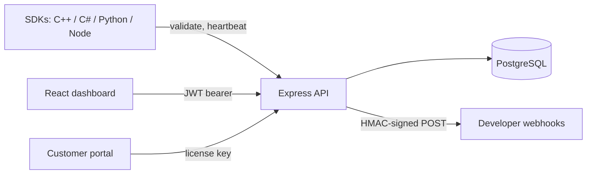

# ShieldAuth

[](https://github.com/bravo-mp4/ShieldAuth/actions/workflows/ci.yml)

ShieldAuth is a software licensing platform. Developers sign up, register their applications, and issue license keys. Their desktop software calls the ShieldAuth API through a small SDK. The API checks the key, binds it to the machine's hardware ID (HWID), and keeps a session alive with heartbeats. End users get a self-service portal for moving a license to a new computer.

It's a full-stack TypeScript project: an Express + PostgreSQL API, a React dashboard, and client SDKs in C++, C#, Python and Node.js.


## What it does

- **License keys bound to hardware.** Each key has a number of HWID slots. The first machines to validate take a slot, and the rest are refused. Slots are assigned under a row lock, so parallel requests can't over-fill them.
- **Sessions and heartbeats.** A successful validation returns a session. Clients send heartbeats, and banning or expiring a license ends its sessions, so the change reaches software that is already running.
- **Developer dashboard.** Applications, licenses (create, ban, delete, notes, CSV export), validation logs and 7-day analytics. Every query is scoped to the signed-in developer's own apps.
- **Customer portal.** Anyone holding a key can see its status and devices, rename a device, and free one slot a week.
- **Signed webhooks.** `license.created` and similar events are POSTed with an HMAC-SHA256 signature header. User-supplied URLs pass an SSRF guard first.
- **Platform admin.** Users with the `admin` role can manage users, extend or expire any license, and blacklist hardware IDs.

| Licenses | Analytics |
| --- | --- |
|  |  |
| **Validation logs** | **Customer license portal** |
|  |  |

## Stack

| Layer | Tech |
| --- | --- |
| API | Node.js 20+, Express 5, TypeScript, `pg`, bcrypt, JSON Web Tokens, Helmet, express-rate-limit |
| Database | PostgreSQL 16 (plain SQL migrations with a small runner) |
| Dashboard | React 18, React Router 7, Vite 7, TypeScript |
| SDKs | C++ (CMake), C# (.NET), Python, Node.js |
| Tests and CI | Vitest + Supertest against a real Postgres; ESLint; GitHub Actions |
| Deploy | Dockerfile for the API (Railway config included), Vercel config for the dashboard |

## How license validation works

```mermaid
sequenceDiagram
    participant App as Your app + SDK
    participant API as ShieldAuth API
    participant DB as PostgreSQL

    App->>API: POST /api/v1/validate {app_id, license_key, hwid}
    API->>DB: BEGIN; SELECT license FOR UPDATE (scoped to app_id)
    alt unknown, banned, expired or blacklisted
        API-->>App: { valid: false }
    else device already bound, or a slot is free
        API->>DB: bind HWID, create session, COMMIT
        API-->>App: { valid: true, session_id, expires_at }
    else every slot taken
        API-->>App: { valid: false, "HWID limit reached" }
    end
    API->>DB: log attempt (shown in the dashboard)

    loop every few minutes
        App->>API: POST /api/v1/heartbeat {session_id}
        API-->>App: 200 while the license is good, 401 once banned, expired or idle
    end
```



## Security

This is an auth project, so it has had a security review. Here is what's in place:

- **Passwords:** bcrypt (cost 12), 8 to 72 bytes. Logins for unknown emails still run a bcrypt compare, so response time doesn't reveal which accounts exist.
- **Tokens:** HS256 JWTs with the algorithm pinned (`alg: none` and algorithm-confusion tokens are rejected), a 12-hour expiry, and a secret that must be set (the server won't start without one and requires 32+ characters in production). Every request re-reads the user, so a ban or role change takes effect at once.
- **Authorization:** every dashboard route is scoped to the caller's own applications. Platform-admin and site-content routes need the `admin` role, which is stored in the database and can't be set at sign-up.
- **Rate limiting:** login and sign-up, license validation, and public write endpoints each have their own limits. `trust proxy` is set explicitly, so clients can't spoof their IP with `X-Forwarded-For`.
- **Input handling:** all SQL is parameterised (including intervals, via `make_interval`), request bodies are capped at 100 kB, inputs are type- and length-checked, and CSV exports escape formula injection.
- **Webhooks:** https only, private, loopback and link-local addresses blocked (including IPv4-mapped IPv6), redirects not followed, and payloads signed rather than sending the secret.
- **Transport and headers:** Helmet with a strict API CSP and HSTS, a CORS allow-list from config, and TLS certificate verification for the database by default.
- **Secrets:** nothing secret is committed. Configuration comes from the environment (see [`backend/.env.example`](backend/.env.example)).

The test suite covers these paths directly: forged and expired tokens, cross-tenant access attempts, SQL injection in admin input, concurrent HWID binding, SSRF targets, and heartbeat revocation.

**Known limitations.** Client-side licensing can always be patched out of a binary by a determined attacker, so this raises the cost of piracy rather than preventing it. Responses aren't yet signed, so the SDKs can't tell a fake ShieldAuth server from the real one. Dashboard tokens live in `localStorage`. Forgot-password and email verification aren't built yet.

## Running it locally

You need Node.js 20+ and Docker (or any PostgreSQL 14+).

```bash
# 1. Start Postgres
docker run -d --name shieldauth-pg -e POSTGRES_PASSWORD=postgres -e POSTGRES_DB=shieldauth -p 5432:5432 postgres:16-alpine

# 2. API
cd backend
npm ci
cp .env.example .env        # defaults work with the container above
npm run seed                # runs migrations, then adds demo data
npm run dev                 # http://localhost:3000

# 3. Dashboard (second terminal)
cd frontend
npm ci
npm run dev                 # http://localhost:5173
```

Sign in with **demo@example.com / demo-password**. The seed script only runs outside production. Then try validating a key the way an SDK would:

```bash
curl -X POST http://localhost:3000/api/v1/validate \
  -H "Content-Type: application/json" \
  -d '{"app_id":"<app id from the dashboard>","license_key":"<a key>","hwid":"my-test-machine"}'
```

### Tests, lint and build

```bash
cd backend
npm test          # Vitest + Supertest; needs Postgres (TEST_DATABASE_URL, default localhost:55432/shieldauth_test)
npm run lint
npm run typecheck
npm run build     # compiles to dist/

cd ../frontend
npm run lint
npm run build     # type-check + Vite production build
```

CI runs all of these on every push and pull request, with a Postgres service container.

### Running in production

`docker build -t shieldauth-api .` builds the API image. On start it applies any pending migrations and then serves on `PORT`. Set `DATABASE_URL`, `JWT_SECRET` and `FRONTEND_URL`. To create the first platform admin, sign up normally and then run `UPDATE users SET role = 'admin' WHERE email = '...'`.

## API overview

All routes are under `/api/v1`.

| Area | Endpoints |
| --- | --- |
| Auth | `POST /auth/register`, `POST /auth/login`, `GET /auth/me` |
| SDK | `POST /validate`, `POST /heartbeat` |
| Applications | `GET /admin/applications`, `POST /admin/app/create`, `GET /admin/app/:id` |
| Licenses | `GET /admin/licenses`, `POST /admin/license/create`, `POST /admin/license/ban`, `/unban`, `DELETE /admin/license/:key`, `POST /admin/licenses/bulk-action`, `GET /admin/licenses/export` |
| Insight | `GET /admin/stats`, `GET /admin/analytics`, `GET /admin/logs` |
| Webhooks | `GET/POST /admin/webhooks`, `PUT/DELETE /admin/webhooks/:id`, `POST /admin/webhooks/:id/test` |
| Customer portal | `GET /public/portal/:key`, `POST /public/portal/:key/unbind/:slot`, `PUT /public/portal/:key/device/:slot/name` |
| Platform admin | `GET /platform/stats`, `GET /platform/users`, `PUT /platform/users/:id/ban`, `PUT /platform/users/:id/role`, `PUT /platform/licenses/:key/extend` |

Webhook receivers verify the `X-ShieldAuth-Signature: t=<unix>,v1=<hex>` header by computing `HMAC-SHA256(secret, "<t>.<raw body>")`.

## Project structure

```text
ShieldAuth/
├── backend/
│   ├── src/
│   │   ├── app.ts              # Express app: middleware, CORS, routing, error handler
│   │   ├── index.ts            # Server entry point
│   │   ├── config.ts           # Environment parsing and validation
│   │   ├── routes.ts           # Dashboard, portal and public routes
│   │   ├── admin-routes.ts     # Platform-admin handlers
│   │   ├── license.ts          # Validation and heartbeat logic
│   │   ├── webhooks.ts         # SSRF guard, signing, delivery
│   │   ├── database.ts         # pg pool and user/password helpers
│   │   └── middleware/         # JWT auth, rate limits, security headers
│   ├── migrations/             # Numbered SQL migrations + runner
│   ├── scripts/seed-demo.ts    # Local demo data
│   └── tests/                  # Vitest + Supertest API tests
├── frontend/                   # React + Vite dashboard and public site
├── sdk/                        # C++, C#, Python and Node.js client SDKs
├── docs/screenshots/
├── Dockerfile                  # API image
└── .github/workflows/ci.yml
```

## Notes

I built this to learn how licensing systems, auth flows and multi-language SDKs fit together. I used AI tools to help design parts of the architecture and write some of the code. I reviewed the core logic myself, and it's covered by the test suite above.

The public marketing pages (pricing, use cases and so on) are part of the project's design exercise. They aren't a commercial offering.

## License

No open-source licence has been chosen yet. All rights reserved.
