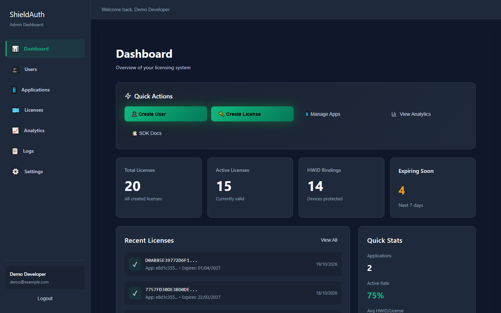
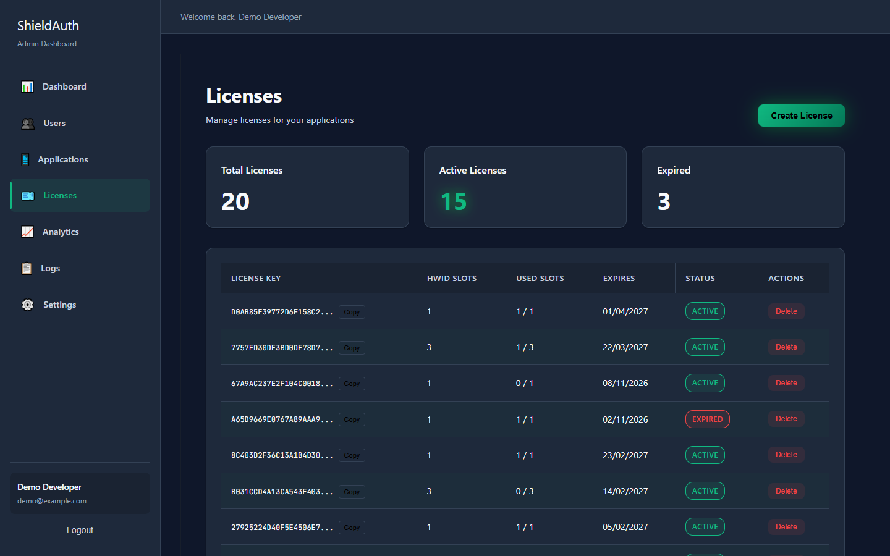
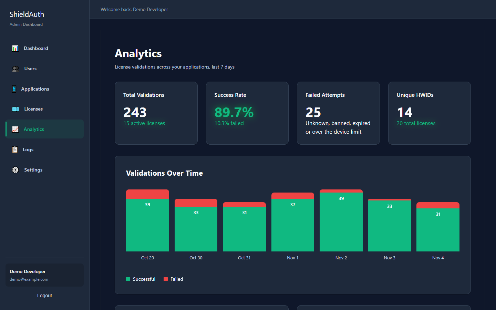
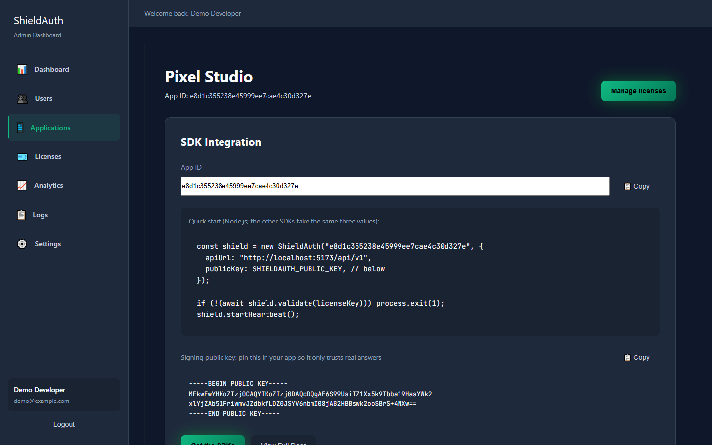
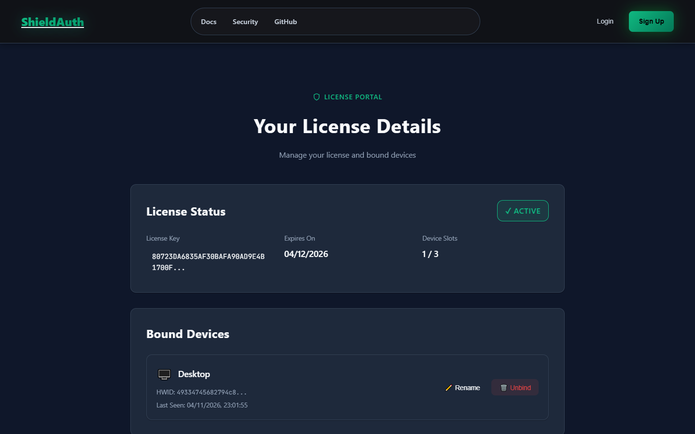
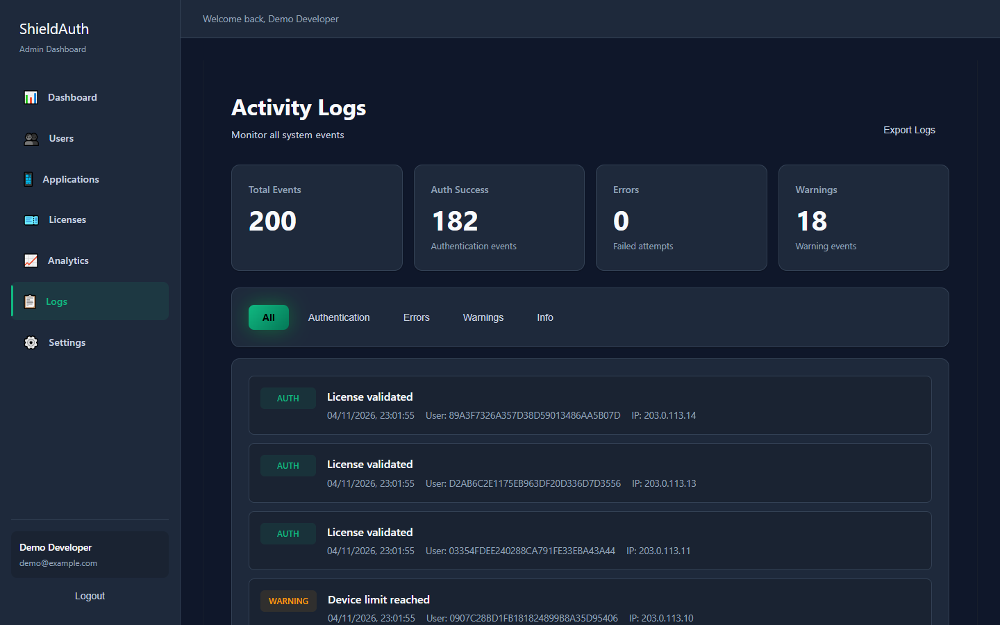
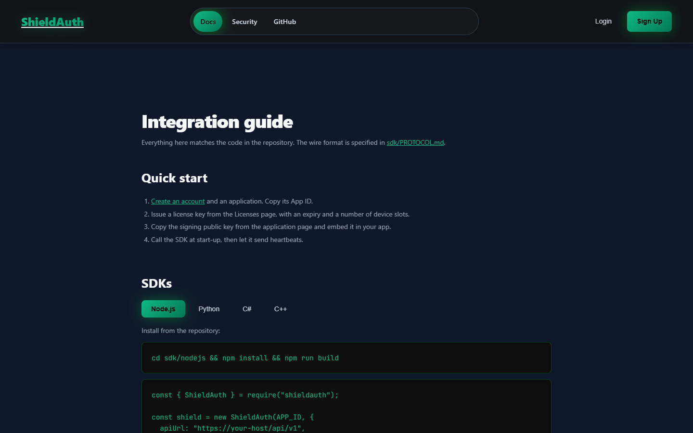
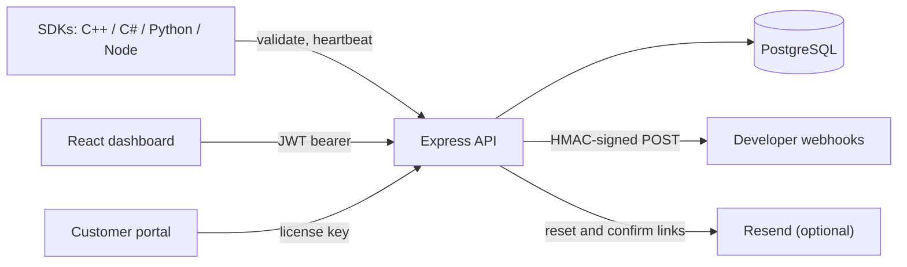

# ShieldAuth

[](https://github.com/bravo-mp4/ShieldAuth/actions/workflows/ci.yml)

ShieldAuth is a software licensing platform for desktop apps.

1. Developers register their applications and issue license keys.
2. Their software asks the ShieldAuth API "is this copy licensed?" through a small SDK.
3. The API checks the key, binds it to the machine's hardware ID (HWID), and sends back a **cryptographically signed** answer. The SDK verifies it, so a fake server can't unlock the app.

End users get a self-service portal for moving a license to a new computer.

It's a full-stack TypeScript project (an Express and PostgreSQL API, plus a React dashboard) with SDKs in **C++, C#, Python and Node.js**. All six parts are tested in CI.



## What it does

- **License keys bound to hardware.** Each key has a number of device slots. The first machines to validate take a slot, and the rest are refused. Slots are assigned under a row lock, so parallel requests can't over-fill them.
- **Signed answers.** Every validation and heartbeat answer, refusals included, is signed with ECDSA P-256. The signature covers a nonce the client chose, so answers can't be forged or replayed. The SDKs check it against a public key pinned in the app ([protocol](sdk/PROTOCOL.md)).
- **Sessions and heartbeats.** Clients keep a session alive with heartbeats. Banning or expiring a license ends its sessions, so the change reaches copies that are already running.
- **Developer dashboard.** Applications, licenses (create, ban, delete, notes, CSV export), validation logs and 7-day analytics. Everything is scoped to the signed-in developer's own apps.
- **Accounts.** Sign-up with email confirmation, password reset by single-use link, and password change. A reset or change signs out every other session.
- **Customer portal.** Anyone holding a key can see its status and devices, rename a device, and free one slot a week.
- **Signed webhooks.** License events are POSTed with an HMAC-SHA256 signature header, after an SSRF check on the URL.
- **Platform admin.** Users with the `admin` role can manage users, extend or expire any license, and blacklist hardware IDs.

| Licenses | Analytics |
| --- | --- |
|  |  |
| **Application and its signing key** | **Customer license portal** |
|  |  |
| **Validation logs** | **Integration docs** |
|  |  |

More: [landing page](docs/screenshots/landing.png), [security page](docs/screenshots/security.png), [account settings](docs/screenshots/settings.png). The screenshots are of a local instance with seeded demo data.

## Stack

| Part | Tech |
| --- | --- |
| API | Node.js 20+, Express 5, TypeScript, `pg`, bcrypt, JWT, Helmet, express-rate-limit |
| Database | PostgreSQL 16 (plain SQL migrations with a small runner) |
| Dashboard | React 18, React Router 7, Vite 7, TypeScript |
| SDKs | Node.js (no runtime dependencies), Python (`cryptography`), C# (netstandard2.1, so Unity works), C++ (WinHTTP + Windows CNG, no third-party libraries) |
| Tests and CI | Vitest + Supertest against real Postgres; node:test, unittest, xUnit and CTest for the SDKs; ESLint; GitHub Actions on Linux and Windows |
| Deploy | Dockerfile for the API (Railway config included), Vercel config for the dashboard |

## How license validation works

```mermaid
sequenceDiagram
    participant App as Your app + SDK
    participant API as ShieldAuth API
    participant DB as PostgreSQL

    App->>API: POST /validate {app_id, license_key, hwid, nonce}
    API->>DB: BEGIN; SELECT license FOR UPDATE (scoped to app_id)
    alt unknown, banned, expired or blacklisted
        API-->>App: { valid: false } + signature
    else device already bound, or a slot is free
        API->>DB: bind HWID, create session, COMMIT
        API-->>App: { valid: true, session_id } + signature
    else every slot taken
        API-->>App: { valid: false, "HWID limit reached" } + signature
    end
    Note over App: accept only if the ECDSA signature verifies with the pinned key,<br/>the nonce is the one sent, and signed_at is fresh

    loop every few minutes
        App->>API: POST /heartbeat {session_id, nonce}
        API-->>App: signed 200 while the license is good, signed 401 once revoked
    end
```



## Security

It's an auth project, so it has had a security review. The controls in place:

- **Passwords:** bcrypt (cost 12), 8 to 72 bytes. Logins for unknown emails still run a bcrypt compare, so response time doesn't reveal which accounts exist. Reset and confirmation links are random, single-use and stored only as SHA-256 hashes. Reset links expire after 30 minutes, and forgot-password answers the same whether or not the email exists.
- **Tokens:** HS256 JWTs with the algorithm pinned, a 12-hour expiry, and a required secret (32+ characters in production). Each token carries a version that a password change or reset bumps. Every request re-reads the user, so bans, role changes and resets apply at once.
- **Authorization:** every dashboard route is scoped to the caller's own applications. Platform-admin routes need the `admin` role from the database, and it can't be set at sign-up.
- **License answers:** ECDSA P-256 signatures over a fixed field list, with a client nonce and a timestamp. Control characters are rejected so fields can't run into each other. Production refuses to start without a signing key.
- **Rate limiting:** login and sign-up, email-sending endpoints, license validation and public writes each have their own limits. `trust proxy` is set explicitly, so clients can't spoof their IP with `X-Forwarded-For`.
- **Input handling:**
  - All SQL is parameterised, intervals included (via `make_interval`).
  - Bodies are capped at 100 kB.
  - Inputs are type- and length-checked.
  - CSV exports escape formula injection.
- **Webhooks:**
  - https only.
  - Private, loopback and link-local addresses are blocked, including IPv4-mapped IPv6.
  - Redirects aren't followed, and the address is re-checked at send time.
  - Payloads are signed instead of sending the secret.
- **Transport and secrets:** Helmet with a strict API CSP and HSTS, a CORS allow-list from config, and database TLS that verifies certificates by default. Nothing secret is committed; see [`backend/.env.example`](backend/.env.example).

The tests attack these paths directly:
- forged, unsigned and expired tokens;
- cross-tenant reads and writes;
- SQL injection in admin input;
- concurrent HWID binding;
- SSRF targets;
- reset-link reuse and expiry;
- signature tampering and replay.

**Known limitations.** Client-side licensing raises the cost of piracy, but a determined attacker can still patch the check out of a binary. Hardware IDs come from the client. Dashboard tokens are kept in `localStorage`.

## Running it locally

You need Node.js 20+ and Docker (or any PostgreSQL 14+).

```bash
# 1. Start Postgres
docker run -d --name shieldauth-pg -e POSTGRES_PASSWORD=postgres -e POSTGRES_DB=shieldauth -p 5432:5432 postgres:16-alpine

# 2. API
cd backend
npm ci
cp .env.example .env        # defaults work with the container above
npm run keygen              # optional: a fixed signing key (paste SIGNING_PRIVATE_KEY into .env)
npm run seed                # runs migrations, then adds demo data
npm run dev                 # http://localhost:3000

# 3. Dashboard (second terminal)
cd frontend
npm ci
npm run dev                 # http://localhost:5173
```

Sign in with **demo@example.com / demo-password**. The seed script only runs outside production. Without `RESEND_API_KEY`, confirmation and reset emails are printed to the API log, so you can open the links from there.

To try an SDK against your local API, copy the App ID and public key from an application's page, then:

```bash
cd sdk/python && pip install .
SHIELDAUTH_APP_ID=... SHIELDAUTH_API_URL=http://localhost:3000/api/v1 \
SHIELDAUTH_PUBLIC_KEY="$(cat key.pem)" python examples/basic.py
```

### Tests, lint and build

| Part | Command | What it covers |
| --- | --- | --- |
| API | `cd backend && npm test` | 84 Vitest + Supertest tests against Postgres (`TEST_DATABASE_URL`, default `localhost:55432/shieldauth_test`) |
| Dashboard | `cd frontend && npm run lint && npm run build` | ESLint, TypeScript, Vite build |
| Node SDK | `cd sdk/nodejs && npm test` | 10 tests |
| Python SDK | `cd sdk/python && python -m unittest discover -s tests` | 7 tests |
| C# SDK | `dotnet test sdk/csharp/ShieldAuth.Tests` | 11 tests |
| C++ SDK (Windows) | `cmake -S sdk/cpp -B build && cmake --build build --config Release && ctest --test-dir build -C Release` | 15 checks |

The SDK suites all verify the same signed examples in [`sdk/test-vectors.json`](sdk/test-vectors.json). They also run against a fake server that forges, replays, back-dates or drops signatures. CI runs every row above on each push and pull request.

### Running in production

`docker build -t shieldauth-api .` builds the API image. On start it applies any pending migrations, then serves on `PORT`.

- **Required:** `DATABASE_URL`, `JWT_SECRET`, `SIGNING_PRIVATE_KEY`, `FRONTEND_URL` and `APP_URL`.
- **To send real email:** `RESEND_API_KEY` and `MAIL_FROM`.
- **First platform admin:** sign up, then run `UPDATE users SET role = 'admin' WHERE email = '...'`.

## API overview

All routes are under `/api/v1`.

| Area | Endpoints |
| --- | --- |
| Account | `POST /auth/register`, `/auth/login`, `/auth/forgot-password`, `/auth/reset-password`, `/auth/change-password`, `/auth/verify-email`, `/auth/resend-verification`; `GET /auth/me` |
| SDK | `POST /validate`, `POST /heartbeat`, `GET /public/signing-key` |
| Applications | `GET /admin/applications`, `POST /admin/app/create`, `GET /admin/app/:id` |
| Licenses | `GET /admin/licenses`, `POST /admin/license/create`, `POST /admin/license/ban`, `/unban`, `DELETE /admin/license/:key`, `POST /admin/licenses/bulk-action`, `GET /admin/licenses/export` |
| Insight | `GET /admin/stats`, `GET /admin/analytics`, `GET /admin/analytics/:app_id`, `GET /admin/logs` |
| Webhooks | `GET/POST /admin/webhooks`, `PUT/DELETE /admin/webhooks/:id`, `POST /admin/webhooks/:id/test` |
| Customer portal | `GET /public/portal/:key`, `POST /public/portal/:key/unbind/:slot`, `PUT /public/portal/:key/device/:slot/name` |
| Platform admin | `GET /platform/stats`, `GET /platform/users`, `PUT /platform/users/:id/ban`, `/role`, `PUT /platform/licenses/:key/extend`, `/expire`, `POST /platform/hwid/blacklist` |

The signed-answer format is in [`sdk/PROTOCOL.md`](sdk/PROTOCOL.md). Webhook receivers verify `X-ShieldAuth-Signature: t=<unix>,v1=<hex>` by computing `HMAC-SHA256(secret, "<t>.<raw body>")`.

## Project structure

```text
ShieldAuth/
├── backend/
│   ├── src/
│   │   ├── app.ts              # Express app: middleware, CORS, routing, error handler
│   │   ├── config.ts           # Environment parsing and validation
│   │   ├── routes.ts           # Account, dashboard, SDK and portal routes
│   │   ├── admin-routes.ts     # Platform-admin handlers
│   │   ├── license.ts          # Validation and heartbeat logic
│   │   ├── signing.ts          # ECDSA signing of license answers
│   │   ├── account.ts          # Reset and confirmation tokens, password changes
│   │   ├── mailer.ts           # Resend, or log when no key is set
│   │   ├── webhooks.ts         # SSRF guard, signing, delivery
│   │   ├── database.ts         # pg pool and user helpers
│   │   └── middleware/         # JWT auth, rate limits, security headers
│   ├── migrations/             # Numbered SQL migrations + runner
│   ├── scripts/                # Demo seed, signing-key generator
│   └── tests/                  # API tests
├── frontend/                   # React + Vite dashboard, docs and customer portal
├── sdk/
│   ├── PROTOCOL.md             # What SDKs send and verify
│   ├── test-vectors.json       # Signed examples every SDK test checks
│   ├── nodejs/  python/  csharp/  cpp/   # each with tests and examples
├── docs/screenshots/
├── Dockerfile                  # API image
└── .github/workflows/ci.yml    # API, dashboard and all four SDKs
```

## Notes

I built this to learn how licensing systems, auth flows and multi-language SDKs fit together. I used AI tools to help design parts of the architecture and write some of the code. I reviewed the core logic myself, and it's covered by the tests above.

## License

No open-source licence has been chosen yet. All rights reserved.
